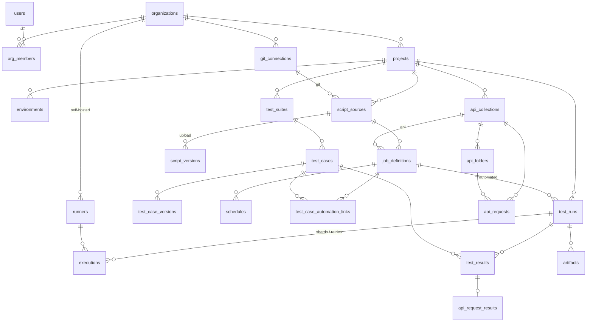

# Teststein data model

The schema lives in numbered, plain-SQL migrations in [`migrations/`](migrations), targeting
**PostgreSQL 15+** (CI and docker-compose use 16).

| Migration | Covers |
|---|---|
| [`001_core.sql`](migrations/001_core.sql) | Phases 0–2: identity and tenancy, projects, test library, script sources, runners, jobs, runs, results |
| [`002_api_testing.sql`](migrations/002_api_testing.sql) | Phase 3: API collections, requests, assertions, chaining, HTTP results |
| [`003_auth_sessions.sql`](migrations/003_auth_sessions.sql) | Sign-in sessions (rotating refresh tokens) |

## Running migrations

```bash
npm run db:migrate      # from the repo root; reads apps/api/.env
```

[`scripts/migrate.mjs`](scripts/migrate.mjs) applies pending files in name order, each in its own
transaction, and records them with a checksum in `schema_migrations`. It holds an advisory lock,
so concurrent deploys can't migrate at the same time. It then grants table access to `APP_DB_ROLE`.

- It connects as the **database owner** (`MIGRATION_DATABASE_URL`). The API connects as
  `teststein_app` (created by [`deploy/postgres/init.sql`](../deploy/postgres/init.sql)), which owns
  nothing and can't bypass row-level security.
- **Applied migrations are never edited.** The runner refuses to continue if an applied file's
  checksum has changed. Make every change a new numbered file. (Before the first release, if you
  do edit one, reset your local database: `docker compose -f deploy/docker-compose.yml down -v`.)

## Overview



## Key ideas

### Organisations are the tenant boundary
- `users` are global; `org_members` gives each user a role per organisation
  (`owner`, `admin`, `member`, `viewer`). `project_members` can override that per project.
- Every tenant-owned table has `org_id`, and children reference parents with
  **composite foreign keys** `(org_id, parent_id) → parent (org_id, id)`. The database
  rejects a row that points at another organisation's data, even if application code has a bug.
- **Row-level security** is on for every tenant table. The API runs each request in a
  transaction and sets the context first:

  ```sql
  begin;
  set local app.user_id = '…';   -- the signed-in user
  set local app.org_id  = '…';   -- the organisation they're working in
  -- queries…
  commit;
  ```

  With only `app.user_id` set, a user can list their own organisations (for the org
  switcher) and nothing else. The API must connect as a **non-owner role without
  `BYPASSRLS`**. Work that spans organisations (looking up API, runner and invitation
  tokens at auth time, signup, the job dispatcher, retention clean-up) uses a separate
  privileged role kept out of request handlers.

### Test library
- `test_suites` form a tree per project; `test_cases` live in a suite.
- Cases get a per-project number (`SHOP-123`) allocated from `projects.case_seq`:
  `update projects set case_seq = case_seq + 1 where id = $1 returning case_seq`.
- Steps are stored as JSON on the case (`[{action, expected}]`). Every save writes a full
  snapshot to `test_case_versions`, which gives history and records exactly which version a result ran against.

### Scripts: uploads and Git
- A `script_source` is either an **upload** (each upload is an immutable `script_versions` row
  pointing to a zip in object storage) or a **Git repo** reached through an org-level `git_connection`.
- Whatever the kind, a run records exactly what it ran: `script_version_id` for uploads,
  `git_ref` + `commit_sha` for Git. Every run can be reproduced.
- Git credentials and `secrets` are **encrypted by the application** (envelope encryption with
  `key_version` for rotation). The database only ever stores ciphertext.

### Job definitions
A `job_definition` is one runnable job: either a job from a
[`teststein.yml`](../packages/spec/teststein-yml.md), or an API collection built in the UI.

| `framework` (the runner) | `language` (derived) | `build_tool` | Typical `libraries` | Runs |
|---|---|---|---|---|
| `pytest` | python | pip | `selenium`, `appium`, `playwright` | a script source |
| `locust` | python | pip | — | a script source |
| `mocha` | javascript | npm | `selenium`, `appium` | a script source |
| `playwright` | javascript | npm | — | a script source |
| `cypress` | javascript | npm | — | a script source |
| `junit5`, `testng` | java | **maven or gradle** (required) | `selenium`, `appium`, `playwright` | a script source |
| `api` | — | — | — | an `api_collections` row |

- `language` is a generated column, so it can't contradict `framework`.
- Exactly one of `source_id` / `api_collection_id` is set, depending on the framework.
- Jobs from a file record `config_path` + `config_job` (the key under `jobs:`). A repo sync
  upserts on `(source_id, config_path, config_job)`, so renaming a job key starts a new history.
- `config` holds the job's YAML as JSON. `runs_on` lists the runner labels the job needs.

### Runs, executions, results
- **`test_runs`** is what users see in "Recent test runs". Manual and automated runs share the
  table, so dashboards and reports treat them the same way.
- **`executions`** are the individual jobs sent to runners: one per shard and per retry attempt.
  The message queue (Redis or NATS) carries execution ids, but this table is the source of truth,
  so queued work can be rebuilt if the queue is lost.
- **`test_results`** has one row per test per run. Manual runs pre-create rows as
  `untested` with an assignee; automated runs insert rows as JUnit XML is parsed.
  `test_case_automation_links` maps a JUnit test name to a library case, so automated
  results show up in that case's history.
- Run counts (`passed_count`, …) are denormalised on `test_runs` so lists stay fast.
  Update them in the same transaction as the results.
- **`artifacts`** (logs, screenshots, videos, traces, reports) live in object storage;
  `expires_at` drives retention by plan.

### Runners
- Self-hosted runners belong to one organisation. Hosted runners (`org_id` null, a later
  SaaS feature) are visible to every organisation but can't be modified by them.
- The agent registers with a one-time `runner_registration_tokens` token, then authenticates
  with its own token. It reports `labels` (`linux`, `docker`, `kvm`, `android:emulator`, …)
  that the scheduler matches against `executions.required_labels`.

### API testing (migration 002)
- **`api_collections` → `api_folders` (tree) → `api_requests`.** Folders and requests are
  constrained to their own collection, so a request can't end up in another collection's folder.
- Collections run like any other job (a `job_definitions` row with `framework = 'api'`), so they
  get environments, schedules, CI triggers and runner selection. They run on **runners**, not
  the API server, so they can reach internal APIs and the server never sends requests on a customer's behalf.
- At run start the resolved collection is copied into `test_runs.config_snapshot`. Editing a
  request never changes what a past run executed.
- Each executed request produces a normal `test_results` row (status, duration, error) plus an
  `api_request_results` row with the HTTP details. Results survive if the request is later deleted.
- `{{name}}` variables resolve in this order: values extracted earlier in the run → environment
  variables → collection variables. `{{secrets.NAME}}` resolves on the runner only and is
  masked in everything stored.

JSON column shapes. The database only checks their top-level type; the API validates the full shape.

```jsonc
// auth (collection / folder / request; null on folder or request = inherit)
{ "type": "none" }
{ "type": "bearer", "token": "{{secrets.API_TOKEN}}" }
{ "type": "basic", "username": "{{user}}", "password": "{{secrets.PASSWORD}}" }
{ "type": "api_key", "in": "header", "name": "X-API-Key", "value": "{{secrets.KEY}}" }   // in: header | query
{ "type": "oauth2_client_credentials", "token_url": "…", "client_id": "…", "client_secret": "{{secrets.CS}}", "scope": "…" }

// query_params / headers
[{ "key": "page", "value": "1", "enabled": true }]

// body
{ "mode": "none" }
{ "mode": "json", "content": { "name": "{{name}}" } }
{ "mode": "text" | "xml", "content": "…" }
{ "mode": "form_urlencoded" | "multipart", "fields": [{ "key": "…", "value": "…", "enabled": true }] }
{ "mode": "graphql", "query": "query($id: ID!) { … }", "variables": { "id": "{{id}}" } }

// assertions
{ "source": "status",        "operator": "equals",  "expected": 200 }
{ "source": "response_time", "operator": "lt",      "expected": 500 }
{ "source": "header", "name": "content-type", "operator": "contains", "expected": "json" }
{ "source": "json_path", "path": "$.items.length()", "operator": "gte", "expected": 1 }
{ "source": "body",          "operator": "matches", "expected": "^OK" }
{ "source": "json_schema",   "schema": { … } }
// operators: equals, not_equals, contains, not_contains, matches, lt, lte, gt, gte, exists, not_exists, is_type

// extract (request chaining)
[{ "variable": "token", "source": "body", "path": "$.access_token" },
 { "variable": "location", "source": "header", "name": "location" }]
```

## Not in this schema yet

| Phase | Tables to add |
|---|---|
| 3 – remaining | Postman / OpenAPI importers (application code, no new tables); a file format for API collections kept in Git |
| 4 – Performance | `perf_samples` (time series: RPS, p50/p95/p99, errors), likely in TimescaleDB or ClickHouse rather than plain Postgres; threshold results on `test_runs` |
| 5 – Appium/Android | `app_builds` (uploaded APKs, later IPAs), `device_profiles` |
| Later | `test_plans` and `milestones`, `defects` and issue-tracker links, `shared_steps`, `custom_fields`, `notifications`, `usage_records` and quotas, SSO configs |

## Tests

```bash
npm test -w @teststein/db
```

[`test/schema.test.mjs`](test/schema.test.mjs) loads every migration into an in-process PostgreSQL 16 ([PGlite](https://pglite.dev)), with no server needed, and checks:
- case-insensitive email uniqueness;
- cross-organisation foreign keys being rejected;
- the framework, build-tool and job-target rules, and `teststein.yml` job keys being unique per file;
- folders and requests staying within their collection;
- `ON DELETE SET NULL` keeping `org_id`, and run and result history surviving deletes;
- the `updated_at` triggers;
- RLS isolation, including the API tables: no context, user-only context, org A vs org B,
  and hosted runners being read-only.

Add a check there whenever a migration adds a table or a constraint. CI runs these on every push,
and the API's end-to-end tests then exercise the same schema on a real PostgreSQL server.
