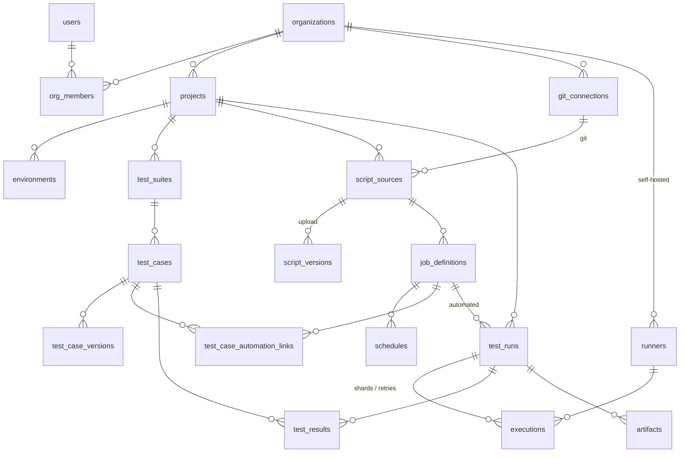

# Teststein data model (phases 0–2)

[`schema.sql`](schema.sql) is the starting schema for the backend: identity and tenancy,
the test library, script sources, runners and execution. It targets **PostgreSQL 15+**
and is written as plain SQL so it can become the first migration in whichever backend
framework we choose.

## Overview



## Key ideas

### Organisations are the tenant boundary
- `users` are global; `org_members` gives each user a role per organisation
  (`owner`, `admin`, `member`, `viewer`). `project_members` can override that per project.
- Every tenant-owned table has `org_id`, and children reference parents with
  **composite foreign keys** `(org_id, parent_id) → parent (org_id, id)`. The database
  rejects a row that points at another organisation's data, even if application code has a bug.
- **Row-level security** is on for every tenant table. The API runs each request in a
  transaction and sets the context first:

  ```sql
  begin;
  set local app.user_id = '…';   -- the signed-in user
  set local app.org_id  = '…';   -- the organisation they're working in
  -- queries…
  commit;
  ```

  With only `app.user_id` set, a user can list their own organisations (for the org
  switcher) and nothing else. The API must connect as a **non-owner role without
  `BYPASSRLS`**. Work that spans organisations (looking up API, runner and invitation
  tokens at auth time, signup, the job dispatcher, retention clean-up) uses a separate
  privileged role kept out of request handlers.

### Test library
- `test_suites` form a tree per project; `test_cases` live in a suite.
- Cases get a per-project number (`SHOP-123`) allocated from `projects.case_seq`:
  `update projects set case_seq = case_seq + 1 where id = $1 returning case_seq`.
- Steps are stored as JSON on the case (`[{action, expected}]`). Every save writes a full
  snapshot to `test_case_versions`, which gives history and records exactly which version a result ran against.

### Scripts: uploads and Git
- A `script_source` is either an **upload** (each upload is an immutable `script_versions` row
  pointing to a zip in object storage) or a **Git repo** reached through an org-level `git_connection`.
- Whatever the kind, a run records exactly what it ran: `script_version_id` for uploads,
  `git_ref` + `commit_sha` for Git. Every run can be reproduced.
- Git credentials and `secrets` are **encrypted by the application** (envelope encryption with
  `key_version` for rotation). The database only ever stores ciphertext.

### Job definitions
A `job_definition` is the stored form of a `teststein.yml` job.

| `framework` (the runner) | `language` (derived) | `build_tool` | Typical `libraries` |
|---|---|---|---|
| `pytest` | python | pip | `selenium`, `appium`, `playwright` |
| `locust` | python | pip | — |
| `mocha` | javascript | npm | `selenium`, `appium` |
| `playwright` | javascript | npm | — |
| `cypress` | javascript | npm | — |
| `junit5`, `testng` | java | **maven or gradle** (required) | `selenium`, `appium`, `playwright` |

`language` is a generated column, so it can't contradict `framework`. `runs_on` lists the
runner labels a job needs (e.g. `{android:emulator}` for Appium), and `config` holds the
rest of the YAML (image, install, command, services, result paths, artifacts, env,
timeout, shards, retries, and load settings and thresholds for Locust).

### Runs, executions, results
- **`test_runs`** is what users see in "Recent test runs". Manual and automated runs share the
  table, so dashboards and reports treat them the same way.
- **`executions`** are the individual jobs sent to runners: one per shard and per retry attempt.
  The message queue (Redis or NATS) carries execution ids, but this table is the source of truth,
  so queued work can be rebuilt if the queue is lost.
- **`test_results`** has one row per test per run. Manual runs pre-create rows as
  `untested` with an assignee; automated runs insert rows as JUnit XML is parsed.
  `test_case_automation_links` maps a JUnit test name to a library case, so automated
  results show up in that case's history.
- Run counts (`passed_count`, …) are denormalised on `test_runs` so lists stay fast.
  Update them in the same transaction as the results.
- **`artifacts`** (logs, screenshots, videos, traces, reports) live in object storage;
  `expires_at` drives retention by plan.

### Runners
- Self-hosted runners belong to one organisation. Hosted runners (`org_id` null, a later
  SaaS feature) are visible to every organisation but can't be modified by them.
- The agent registers with a one-time `runner_registration_tokens` token, then authenticates
  with its own token. It reports `labels` (`linux`, `docker`, `kvm`, `android:emulator`, …)
  that the scheduler matches against `executions.required_labels`.

## Not in this schema yet

| Phase | Tables to add |
|---|---|
| 3 – API functional | `api_collections`, `api_requests` (method, URL, headers, body, assertions), `api_request_results` |
| 4 – Performance | `perf_samples` (time series: RPS, p50/p95/p99, errors), likely in TimescaleDB or ClickHouse rather than plain Postgres; threshold results on `test_runs` |
| 5 – Appium/Android | `app_builds` (uploaded APKs, later IPAs), `device_profiles` |
| Later | `test_plans` and `milestones`, `defects` and issue-tracker links, `shared_steps`, `custom_fields`, `notifications`, `usage_records` and quotas, SSO configs |

## Validating changes

The schema has been loaded into PostgreSQL 16 and checked for: case-insensitive email
uniqueness, cross-organisation foreign keys being rejected, the framework/build-tool rules,
`ON DELETE SET NULL` keeping `org_id`, the `updated_at` triggers, and RLS isolation
(no context, user-only context, org A vs org B, hosted runners read-only).
Once the backend exists, those checks should become automated migration tests.
